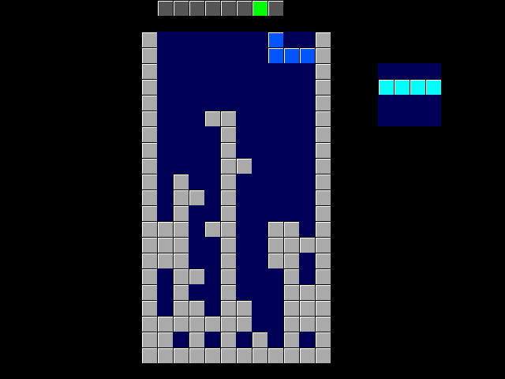

## How it works

Classic Tetris on a 10x20 board, drawn on a 640x480 @ 60 Hz VGA screen through the
TinyVGA PMOD on the dedicated outputs. It fits in a single 1x1 tile (87% cell
utilization after clock-tree synthesis).

- **Board as a rotating ring**: the 200 cells live in a 200-bit circular shift
  register that moves one cell per clock. The flip-flops have no reset, enable or read
  multiplexers. Only one cell is visible at a time (the "tap"), and every game
  operation is one full rotation (200 clocks): CHECK (collision), LOCK (write piece),
  SCAN (find a full row), CLEAR (remove a row) and WIPE (empty the board).
- **Shared counters**: the VGA x counter is built from the ring position
  (x = 200·q + 10·row + col), so a scanline is exactly 4 board rotations. A 10-bit row
  buffer copies the row being drawn as it passes the tap. During vertical blank, the
  same buffer is the delay line that moves rows down when a line is cleared.
- **One piece hit test**: one shape lookup (7 base shapes rotated by coordinate
  transform) tests the ring cell during game passes, and while drawing it tests the
  beam's cell for both the falling piece and the next-piece preview box.
- **Display**: 20x20 px blocks, the board at x 200..399, y 40..439, with walls and a
  floor. The falling piece has its own colour (I cyan, O yellow, T purple, S green,
  Z red, J blue, L orange) and locked blocks are grey. The number of cleared lines is
  shown in binary as 8 green "LEDs" at the top. The next piece is shown in a box to the
  right of the board.
- **Gravity**: one row every 63 frames, getting faster every 4 cleared lines (down to
  every 7 frames).
- **Random pieces**: a 10-bit maximal-length LFSR steps every clock *only while no
  button is held*. Its state depends on exactly how many 40 ns clocks the player has
  held buttons in total, which no human can repeat. When a piece spawns, 3 LFSR bits
  pick a start index into a **7-bag**: every group of 7 pieces contains each
  tetromino exactly once. The piece dealt from the bag goes into the preview, and the
  previous preview piece starts falling.
- **Game over**: the walls and stack turn red. Press any button to restart.

## How to test

Connect a TinyVGA PMOD to the outputs and buttons to `ui[4:0]`. Set the clock to
25.175 MHz (25 MHz works on most monitors). After reset the empty board is shown;
press any button to start.

| Input | Action |
|-------|--------|
| ui[0] | Move left (auto-repeat when held) |
| ui[1] | Move right (auto-repeat when held) |
| ui[2] | Rotate clockwise |
| ui[3] | Soft drop (hold) |
| ui[4] | Hard drop |

## External hardware

- TinyVGA PMOD (or any VGA PMOD with the Tiny Tapeout pinout) on the output pins
- 5 push buttons (active high) on the input pins, e.g. Tiny Tapeout input PMOD
